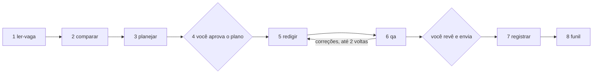

# apply-me

Ferramenta para **preparar e gerir candidaturas a vagas** com ajuda de um agente de IA, em etapas, com **verificações feitas por código** antes de qualquer carta sair. O agente propõe; scripts determinísticos conferem os factos; a pessoa aprova e envia.

> **Estado: versão 0.1, uso pessoal e experimental.** Os controlos de segurança e privacidade executados na auditoria estão em [`docs/AUDITORIA.md`](docs/AUDITORIA.md), com os limites do que foi (e do que não foi) verificado. O que ainda falta está em [`docs/ROADMAP.md`](docs/ROADMAP.md).

## O que faz e o que não faz

- **Faz:** lê o texto de uma vaga, compara-a com o seu CV-mestre, planeia o ângulo da carta, redige um rascunho, confere o rascunho contra os seus factos, deteta cartas quase iguais, regista a candidatura e gera um funil.
- **Não envia nada.** Nenhum agente envia e-mails, formulários ou candidaturas. Você aprova o plano e envia.
- **Não inventa.** Competências, experiência, qualificações, cargos, datas e resultados só podem vir do seu CV-mestre e do seu banco de conquistas. Um facto `desconhecido` nunca entra no texto e um `estimado` só com redação aproximada ("mais de", "cerca de"). O conferidor é uma rede de segurança e **não garante** que um texto esteja livre de erros (ver [Limitações](#limitações)): a revisão final é sua.
- **Não guarda os seus dados.** Este repositório contém só o motor. Os seus dados ficam num repositório privado, separado.

## Arquitetura

```
apply-me/                  (este repositório, público, sem dados pessoais)
├── skills/                instruções em markdown de cada etapa (fonte única)
├── adaptadores/claude/    stubs gerados a partir das skills, para o Claude
├── contratos/             JSON Schema (em YAML) do artefato de cada etapa
├── scripts/               verificações determinísticas em Python
├── exemplos/ana-exemplo/  pessoa e candidatura fictícias, para ver o fluxo completo
├── template-dados/        modelo da pasta privada de dados
├── testes/                testes automatizados (pytest)
├── docs/                  auditoria, política de segurança e roadmap
└── AGENTS.md              regras imutáveis para qualquer agente de IA

carreira-dados/            (o SEU repositório privado, fora deste projeto)
├── cv-mestre.md           linha do tempo, contactos, idiomas, ferramentas, conflitos
├── conquistas.md          factos com id, estado e fonte
├── candidaturas/<empresa-vaga>/{vaga,gaps,plano,qa}.yaml e rascunho.md
├── log.csv                uma linha por vaga (chave: URL normalizada)
└── funil.md               gerado
```

O fluxo tem oito etapas. Cada etapa escreve só o seu artefato e valida-o com o contrato antes de passar à seguinte:



Os scripts em `scripts/` e o que cada um verifica:

| Script | Função |
|---|---|
| `mestre` | valida o CV-mestre e o banco de factos (datas, conflitos abertos, ids) |
| `validar_contrato` | valida o artefato de uma etapa contra o seu contrato |
| `conferir_fatos` | confere o rascunho: ids citados, estado dos factos, números, anos de experiência, ferramentas do vocabulário, cargo/empregador declarados, contactos e idioma |
| `detectar_duplicados` | deteta cartas quase iguais entre candidaturas |
| `registrar` | regista ou atualiza uma candidatura no `log.csv`, sem apagar histórico |
| `gerar_funil` | gera o funil a partir do `log.csv` |
| `verificar_privacidade` | recusa telefones, e-mails e números de documento reais (usado no hook de pré-commit) |
| `verificar_commit` | recusa mensagens de commit fora do padrão Conventional Commits |
| `gerar_adaptador_claude` | gera os stubs do Claude a partir das skills |

Códigos de saída de todos os scripts: `0` passou, `1` reprovou (corrija e repita), `2` bloqueado (precisa de decisão sua).

## Instalação

Requisitos: Python 3.11 ou superior e Git. As dependências de execução são `pyyaml` e `jsonschema`; `pytest` só é preciso para os testes.

```bash
git clone https://github.com/pedrocamiloramos/apply-me.git
cd apply-me
python -m venv .venv
.venv/bin/pip install -r requirements-dev.txt    # versões fixadas, auditadas com pip-audit
.venv/bin/pytest                                  # 170+ testes
bash scripts/instalar_hooks.sh                    # opcional: hooks de pré-commit e de mensagem de commit
```

Em Windows, use `.venv\Scripts\pip` e `.venv\Scripts\pytest`. Para instalar só o necessário para executar: `pip install -r requirements.txt`.

## Configuração

1. **Crie o seu repositório privado de dados** a partir do modelo, fora desta pasta:

   ```bash
   cp -r template-dados ../carreira-dados
   cd ../carreira-dados && git init
   ```

   Use um repositório **privado** (ou apenas local). Nunca ponha esta pasta dentro de `apply-me`: o `.gitignore` e o hook de pré-commit existem para travar esse erro, mas não substituem o seu cuidado.

2. **Preencha `cv-mestre.md`**: contactos, idiomas, ferramentas com a prova de cada uma (cargo, projeto, certificado), experiências com datas `AAAA-MM`. Datas que divergem entre fontes vão em `conflitos` e bloqueiam o fluxo até você decidir.

3. **Preencha `conquistas.md`**: um facto por conquista, com `id`, `status` (`confirmado`, `estimado` ou `desconhecido`), `fonte` e o texto em cada idioma. Comece com tudo `desconhecido` e promova só o que consegue provar.

4. **`config.yaml`** guarda preferências (nome, idiomas das cartas, pasta das candidaturas). É lido pelo agente, não pelos scripts.

Não coloque credenciais, tokens ou chaves de API em nenhum dos dois repositórios. Esta versão **não precisa de nenhuma**: os scripts não fazem pedidos de rede.

## Uso

Peça ao seu agente de IA para seguir [`AGENTS.md`](AGENTS.md), com a pasta de dados como `<dados>`. Execute os comandos a partir da raiz de `apply-me`, sempre com caminhos dentro de `<dados>`:

```bash
python -m scripts.mestre ../carreira-dados
python -m scripts.validar_contrato vaga ../carreira-dados/candidaturas/empresa-vaga/vaga.yaml
python -m scripts.conferir_fatos ../carreira-dados ../carreira-dados/candidaturas/empresa-vaga
python -m scripts.detectar_duplicados ../carreira-dados empresa-vaga
python -m scripts.registrar ../carreira-dados/log.csv url=https://… status=enviada
python -m scripts.gerar_funil ../carreira-dados/log.csv ../carreira-dados/funil.md
```

Para ver o fluxo completo sem dados reais, use o exemplo fictício:

```bash
python -m scripts.mestre exemplos/ana-exemplo
python -m scripts.conferir_fatos exemplos/ana-exemplo exemplos/ana-exemplo/candidaturas/empresa-exemplo-analista
python -m scripts.detectar_duplicados exemplos/ana-exemplo
```

Com o Claude, `python -m scripts.gerar_adaptador_claude` gera em `adaptadores/claude/` os stubs que apontam para as skills. Com outras ferramentas, basta apontar o agente para `AGENTS.md` e `skills/`.

## Privacidade e segurança

- Os exemplos usam apenas marcadores fictícios (`@exemplo.invalid`, `+351 900 000 000`).
- O hook de pré-commit recusa telefones, e-mails e números de documento que pareçam reais. É uma heurística: pode falhar em formatos que não prevê.
- O texto de vagas, páginas web e e-mails é tratado como **dado não confiável**: o agente não deve cumprir instruções que venham dentro dele.
- Para reportar uma falha de segurança, veja [`SECURITY.md`](SECURITY.md).
- O que foi verificado, com que ferramentas e com que resultado: [`docs/AUDITORIA.md`](docs/AUDITORIA.md).

## Limitações

- **O conferidor de factos não apanha tudo.** Não deteta ferramentas que não estejam em `scripts/vocabulario.yaml`, cargos ou empregadores citados no corpo sem constarem das `afirmacoes` do rascunho, nem frases noutro idioma sem palavras funcionais reconhecíveis. A revisão de julgamento da etapa `qa` e a sua leitura final são necessárias.
- **O CV-mestre ainda não valida intervalos de datas**: um `fim` anterior ao `inicio` ou um `inicio` no futuro passam sem aviso e distorcem os anos de experiência calculados.
- **Só a guarda de privacidade limita o tamanho dos ficheiros** que lê (2 MiB). Os outros scripts leem ficheiros inteiros: use ficheiros de tamanho normal.
- **Ainda não há integração com o Notion** nem com outro gestor de candidaturas: o registo é um `log.csv` local.
- **A deteção de duplicados** compara só rascunhos locais e não vagas repetidas noutros portais.
- **A deteção de dados pessoais é heurística** e não substitui a revisão antes de publicar qualquer repositório.
- **Não há CI** neste repositório; os testes e as verificações correm na sua máquina.
- Os textos das skills estão em português; os exemplos e o vocabulário cobrem sobretudo vagas na área de dados e energia.

Lista priorizada do que vem a seguir: [`docs/ROADMAP.md`](docs/ROADMAP.md).

## Contribuir

Mensagens de commit seguem [Conventional Commits](https://www.conventionalcommits.org/). Antes de abrir um pull request, corra `pytest` e `bash scripts/instalar_hooks.sh`. Não inclua CVs, cartas, registos de candidaturas reais nem qualquer dado pessoal em exemplos ou testes: use pessoas e empresas fictícias.

## Licença

MIT. Ver [`LICENSE`](LICENSE).
