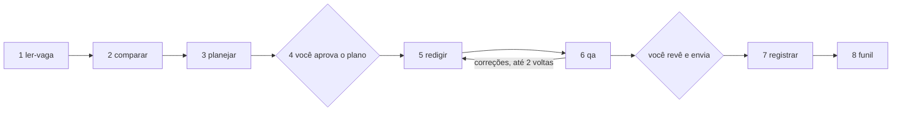

# Carreira Motor

Um fluxo de candidaturas em etapas, em que cada etapa tem um papel (ler a vaga, comparar, planejar, redigir, conferir, registrar, analisar o funil) e **scripts determinísticos verificam os factos** antes de qualquer carta sair. Funciona com Claude ou qualquer outra ferramenta de IA que leia markdown e rode comandos.

## O problema

Cartas escritas à pressa com IA falham sempre da mesma maneira: ferramentas que a pessoa nunca usou, anos de experiência que não batem com a linha do tempo, cargos com o nome errado, fecho em outro idioma e a mesma carta enviada para vagas diferentes. Este projeto prende cada um desses erros num teste e num código de saída.

## Como funciona



- **Nenhum agente envia** e-mails ou formulários. Você aprova o plano e envia a candidatura.
- Cada frase factual da carta termina em `[f:id]`, apontando para um facto do seu banco de conquistas. Facto `desconhecido` nunca entra no texto; `estimado` só com "mais de" ou "cerca de".
- A verificação é código, não opinião: `conferir_fatos`, `detectar_duplicados`, `validar_contrato`. A revisão de tom e de ângulo é manual guiada: o agente propõe, você decide.
- Códigos de saída: `0` passou, `1` reprovou, `2` bloqueado (precisa de decisão sua).

As regras completas estão em [`AGENTS.md`](AGENTS.md) e as instruções de cada etapa em [`skills/`](skills).

## Exemplo completo

[`exemplos/ana-exemplo/`](exemplos/ana-exemplo) traz uma pessoa fictícia com CV-mestre, 8 factos (um estimado, um desconhecido) e uma candidatura que percorre as cinco etapas com todos os contratos válidos. O teste `testes/test_fim_a_fim.py` roda esse caminho inteiro.

```bash
python -m scripts.mestre exemplos/ana-exemplo
python -m scripts.conferir_fatos exemplos/ana-exemplo exemplos/ana-exemplo/candidaturas/empresa-exemplo-analista
python -m scripts.detectar_duplicados exemplos/ana-exemplo
python -m scripts.gerar_funil exemplos/ana-exemplo/log.csv /tmp/funil.md
```

## Usar com os seus dados

Os seus dados **nunca** entram neste repositório. Crie um repositório privado ao lado:

```bash
cp -r template-dados ../carreira-dados
cd ../carreira-dados && git init
```

1. Preencha `cv-mestre.md` (linha do tempo, contactos, ferramentas com a prova de cada uma).
2. Preencha `conquistas.md`; todos os factos começam `desconhecido`, promova só o que consegue provar.
3. Peça à sua IA para seguir `AGENTS.md` com a pasta `carreira-dados` como dados.

No Claude, `python -m scripts.gerar_adaptador_claude` gera os stubs em `adaptadores/claude/`, que apontam para as skills.

## Instalação

```bash
python -m venv .venv && .venv/bin/pip install pyyaml jsonschema pytest
bash scripts/instalar_hooks.sh      # recusa dados reais e commits fora do padrão
.venv/bin/pytest
```

## Privacidade

O hook `pre-commit` recusa telefones, e-mails e números de documento reais. Os exemplos usam apenas marcadores fictícios (`@exemplo.invalid`, números `900 000 000`). Mensagens de commit seguem Conventional Commits.

## Licença

MIT.
